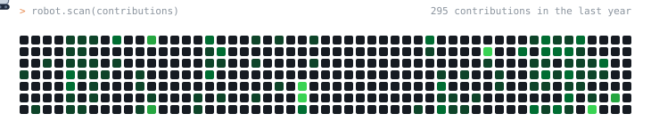
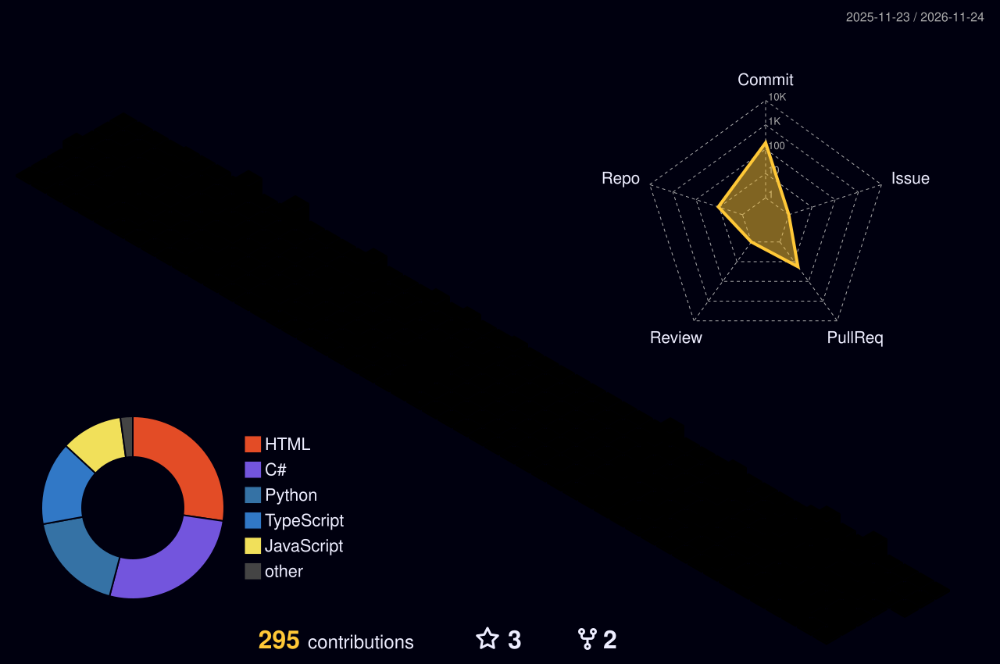

<!-- ============ HERO ============ -->
<p align="center">
  
</p>

<p align="center">
  <a href="https://git.io/typing-svg">
    
  </a>
</p>

<p align="center">
  <a href="https://linkedin.com/in/shahriar-hossain-rimon-6545872b9"></a>
  <a href="mailto:mdshrhussain@gmail.com"></a>
  <a href="https://github.com/SHAHRIAR-HOSSAIN-RIMON"></a>
  
</p>

<!-- Optional: add LeetCode / Codeforces badge here
<a href="https://leetcode.com/u/YOUR_USERNAME"></a>
-->

<!-- ============ ROBOT (contribution scanner) ============ -->
<p align="center">
  <picture>
    <source media="(prefers-color-scheme: dark)" srcset="https://raw.githubusercontent.com/SHAHRIAR-HOSSAIN-RIMON/SHAHRIAR-HOSSAIN-RIMON/output/robot-contrib-dark.svg"/>
    <source media="(prefers-color-scheme: light)" srcset="https://raw.githubusercontent.com/SHAHRIAR-HOSSAIN-RIMON/SHAHRIAR-HOSSAIN-RIMON/output/robot-contrib.svg"/>
    
  </picture>
</p>

---

## `$ whoami`

I'm a Computer Science & Engineering student at the **University of Asia Pacific**. I practice data structures and algorithms, study machine learning and deep learning (currently with PyTorch), and build full-stack products with solid system-design fundamentals: REST APIs, secure authentication, real-time features, and AI-powered search.

```python
class Developer:
    name            = "Shahriar Hossain Rimon"
    studying        = "CSE @ University of Asia Pacific"
    problem_solving = ["Data Structures", "Algorithms", "Contests & Hackathons"]
    ai_ml           = ["Machine Learning", "Deep Learning (PyTorch)", "Semantic Search"]
    engineering     = ["System Design", "REST API Design", "Auth & RBAC", "Real-time Systems"]
    languages       = ["Python", "C#", "TypeScript", "C", "C++", "Java", "JavaScript"]
    open_to         = ["Internships", "Entry-level roles", "Research", "Collaboration"]

    def motto(self):
        return "Build with curiosity. Engineer with purpose."
```

### 🎮 Quest Log

| Status | Quest | Details |
|:-:|---|---|
| 🟢 | **Main Quest** | Building full-stack apps with APIs, auth, real-time features, and AI search |
| 🟢 | **Skill Tree** | Machine learning and deep learning with PyTorch |
| 🟡 | **Daily Grind** | Data structures and algorithms through contests and hackathons |
| 🔵 | **Looking for Party** | Software engineering internships, entry-level roles, research |

---

## 🚀 Featured Projects

<table>
  <tr>
    <td width="50%" valign="top">
      <h3>🛒 Sports Gear Marketplace</h3>
      <p>Full-stack marketplace for buying and renting sports equipment, with real-time chat and seller tools.</p>
      <p>
        
        
        
        
        
      </p>
      <b>Highlights</b>
      <ul>
        <li>Buyer and seller workflows</li>
        <li>Real-time chat with WebSockets</li>
        <li>Wallet and mock payment/refund flows</li>
        <li>Reviews, reporting, seller analytics dashboard</li>
      </ul>
      <p><a href="https://github.com/SHAHRIAR-HOSSAIN-RIMON/sportsgear"><b>Explore repository →</b></a></p>
    </td>
    <td width="50%" valign="top">
      <h3>🧠 KnowledgeHub</h3>
      <p>AI-powered knowledge management platform that organizes information and makes it easy to find.</p>
      <p>
        
        
        
        
      </p>
      <b>Highlights</b>
      <ul>
        <li>Hierarchical pages and version history</li>
        <li>Semantic search via OpenRouter</li>
        <li>File attachments and workspace permissions</li>
        <li>Team invitations and audit trails</li>
      </ul>
      <p><a href="https://github.com/SHAHRIAR-HOSSAIN-RIMON/KnowledgeHub"><b>Explore repository →</b></a></p>
    </td>
  </tr>
  <tr>
    <td colspan="2" valign="top">
      <h3>✈️ TravelMatch <sup>team project · in progress</sup></h3>
      <p>Collaborative trip marketplace connecting travelers with local guides and tour organizers through trip requests, proposals, and organized travel experiences.</p>
      <p>
        
        
        
        
        
      </p>
      <b>My contributions</b>
      <ul>
        <li>Registration, JWT authentication, role-based authorization</li>
        <li>Trip request and profile API endpoints with service-layer logic</li>
        <li>Organized trip management and database migrations</li>
        <li>Automated backend testing and API validation</li>
      </ul>
      <p><i>Layered architecture · Sandbox payment flows</i></p>
      <!-- Add repo link: <p><a href="https://github.com/..."><b>Explore repository →</b></a></p> -->
    </td>
  </tr>
</table>

---

## 🧰 Tech Arsenal

<p align="center">
  
  <br/>
  
  <br/>
  
</p>

<details>
<summary><b>🔍 Also familiar with</b> (click to expand)</summary>
<br/>

Django REST Framework · Django Channels · Entity Framework Core · JWT · Swagger/OpenAPI · REST API design · Role-based access control · Render

</details>

---

## 🏆 Achievements Unlocked

| | Achievement |
|:-:|---|
| 🥉 | **5th Place**, GreenCon Hackathon 2025 |
| 🎓 | **Dean's Award ×2**, University of Asia Pacific |
| 💻 | IEEE Student Branch OSCILLION Programming Contest · Micro-Ops Hackathon (CUET CSE Fest 2025) · BUP CSE Fest Hackathon · Technovation '25 (Programming Hero) |
| 📜 | Generative AI Productivity · Cybersecurity Fundamentals (LinkedIn Learning) |

---

## 📊 Player Stats

<p align="center">
  
  
</p>

<p align="center">
  
</p>

<p align="center">
  
</p>

<!-- 3D contribution skyline (generated by .github/workflows/profile-3d.yml) -->
<p align="center">
  
</p>

---

## 🤝 Let's Build Something

Algorithms, machine learning, system design, or a hackathon idea: I'm always up for a good technical conversation.

<p align="center">
  <a href="https://linkedin.com/in/shahriar-hossain-rimon-6545872b9"></a>
  <a href="mailto:mdshrhussain@gmail.com"></a>
</p>

<p align="center">
  
</p>
